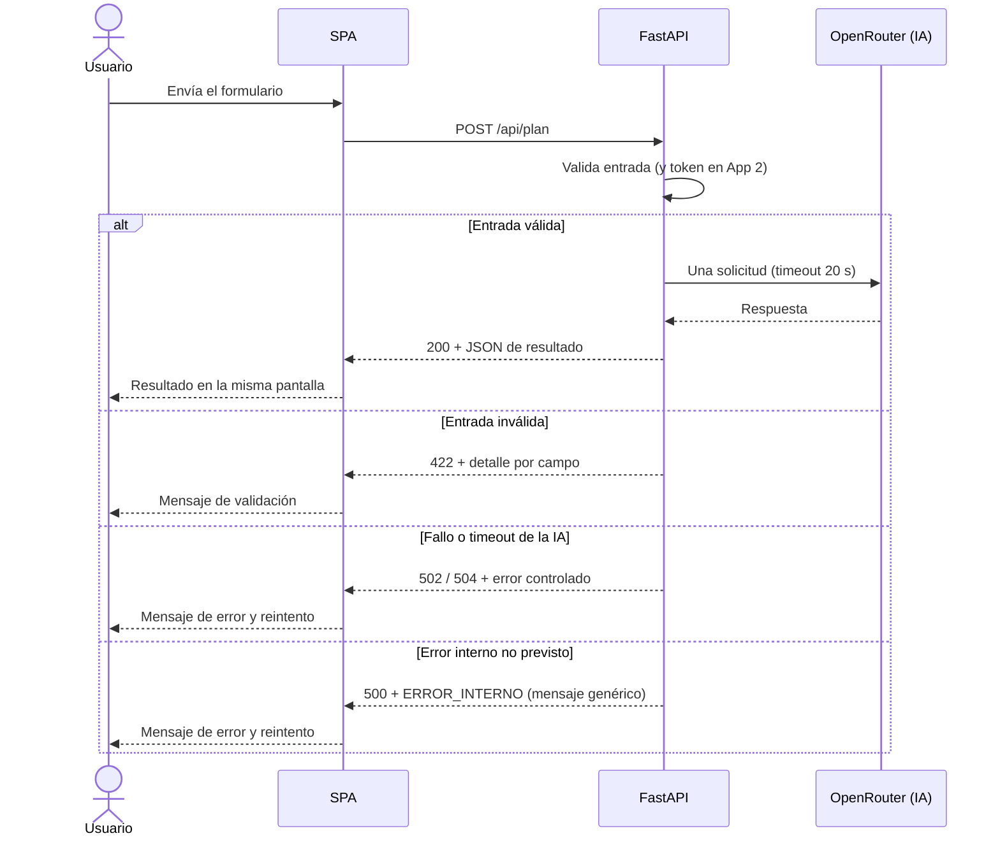

# Especificación de Requisitos del Software (ERS)

> **Leyenda de alcance:** **[App 1]** = aplicación manual e incremental (sin identidad externa).
> **[App 2]** = aplicación nueva desde cero con GitHub Spec Kit y Clerk (mismo alcance funcional + autenticación).
> **[Ambas]** = requisito común a las dos aplicaciones. Esta ERS es la base común; la
> revisión específica de App 2 (Clerk) está en el **Anexo C**.

## Datos del documento

| Campo | Valor |
|---|---|
| Nombre del proyecto | Planificador de itinerarios (mini app web con una API de IA) |
| Autores | Alberto Ortiz y Manuel Montalbán |
| Curso y grupo | Aprendizaje automático: gestión de datos y entrenamiento — grupo de 2 integrantes |
| Asignatura o módulo | Desarrollo de componentes software para sistemas de aprendizaje automático (UD1) |
| Docente | Pendiente |
| Fecha | 16/10/2026 |
| Versión | 2.1 |
| Estado | Borrador |

> Este documento se entrega como `docs/ERS.md`, ubicación que exige el enunciado.

### Historial de cambios

| Versión | Fecha | Autor | Cambios realizados |
|---|---|---|---|
| 0.1 | 08/10/2026 | Equipo | Primera versión del documento. |
| 1.0 | 08/10/2026 | Equipo | Requisitos indicados por el docente: pantalla única, sin persistencia, Python + Vite, una sola API de IA, OpenRouter gratuito y despliegue en Vercel. |
| 2.0 | 08/10/2026 | Equipo | Adaptación completa al enunciado PR01-UD1: dos aplicaciones (App 1 manual / App 2 con Spec Kit y Clerk), alcance reducido a una sola función útil, catálogo ajustado a 5 RF y 4 RNF, exclusiones obligatorias, despliegues Vercel y Docker/EC2 y eliminación de ejemplos de la plantilla. |
| 2.1 | 16/10/2026 | Manuel | Puesta al día con lo implementado en App 1 (H1–H6): error `500 ERROR_INTERNO` en RF-03, OBJ-02, INT-02 y diagramas; formato fijo `Mañana:`/`Tarde:`/`Noche:` del prompt (RF-03, CA-RF03-05) y tarjetas del resultado (RF-04); compañía opcional dentro de `gustos` (1.3, RF-01, IU-01); Figma como referencia visual y movido a `docs/evidencias/figma/`; SUP-01 resuelta; ACT-02 con 2 integrantes; RNF-02 con `/docs` cerrado y cabeceras de seguridad; PEN-08 (`413`); trazabilidad enlazada con los IDs de `docs/pruebas.md`; revisión cruzada pendiente (10.2); orden y formato de los CA. |

## 1. Introducción

### 1.1. Propósito del documento

Define **qué debe hacer** la mini aplicación para satisfacer el enunciado PR01-UD1 y servir
como referencia verificable durante el desarrollo y la defensa. La utilizarán el **equipo de
desarrollo** (para decidir, implementar y justificar), el **docente** (para comprobar que el
alcance, los requisitos y su trazabilidad cumplen la rúbrica) y cualquier revisor que quiera
entender el sistema sin leer el código.

### 1.2. Problema y objetivos

**Problema o necesidad:** una persona que visita una ciudad quiere ideas sencillas para
organizar un día (qué hacer y en qué orden), pero buscar y combinar opciones a mano es lento.
Se necesita una mini aplicación web con una única función útil: a partir de unos pocos datos,
devolver un plan de un día usando **una API de inteligencia artificial**, con un proceso de
desarrollo probado y documentado (análisis, pruebas, Git, despliegue y defensa).

| ID | Objetivo del proyecto | Indicador de logro |
|---|---|---|
| OBJ-01 | Ofrecer la única función útil: entrada → plan de un día en la misma pantalla | Con una entrada válida, la pantalla muestra el resultado sin navegar a otra vista (CA-RF04-01) |
| OBJ-02 | Garantizar un contrato HTTP claro y manejar los errores sin exponer detalles internos | 200/422/502/504/500 (y 401 en App 2) documentados y comprobados con pruebas (CA-RF03-02, RNF-01) |
| OBJ-03 | Cumplir la regla de simplicidad: una pantalla, una API de IA, cero persistencia | Inspección de código: sin router, sin BD, sin `localStorage`/`sessionStorage`/IndexedDB (RNF-02) |
| OBJ-04 | Demostrar dos procesos de desarrollo distinguibles (manual vs. dirigido por especificaciones) | Historial con hitos H0–H7 (App 1) y artefactos de Spec Kit previos al código (App 2) |
| OBJ-05 | Desplegar y autenticar según el enunciado | App 1 en Vercel; App 2 en Vercel (Clerk) y en AWS EC2 con Docker (RNF-03 solo en lo que afecta a esta ERS: ver Anexo C) |

### 1.3. Alcance

**El sistema incluirá:**

- **[Ambas]** Una única pantalla (SPA) con un formulario de entrada (ciudad, fecha, personas, gustos y, opcionalmente, con quién se viaja, que se envía dentro de `gustos`) y la zona de resultado.
- **[Ambas]** Backend Python/FastAPI que valida la entrada, realiza **una** llamada a la API de IA y devuelve JSON.
- **[Ambas]** Un resultado de texto (plan de un día) mostrado en la misma pantalla, con estados de espera y error.
- **[App 1]** Desarrollo incremental del equipo y despliegue de frontend y backend en Vercel.
- **[App 2]** Proyecto nuevo con GitHub Spec Kit (especificación, plan y tareas previos al código).
- **[App 2]** Autenticación con **Clerk** (acceso con Google) mediante componente modal en la misma pantalla, con verificación del token en backend.
- **[App 2]** Despliegue en Vercel y despliegue final con **Docker en AWS EC2**.

**Queda fuera del alcance (obligatorio según el enunciado):**

- Bases de datos de cualquier tipo (SQL, NoSQL, SQLite, en memoria, vectoriales) y **cualquier persistencia** de la aplicación (históricos, cachés, `localStorage`, `sessionStorage`, IndexedDB, ficheros con solicitudes o resultados).
- CRUD, catálogos, reservas, tareas gestionables, paneles de administración, dashboards, estadísticas y perfiles.
- Segunda pantalla, vistas o rutas de navegación (no se usa router).
- Gestión de usuarios propia: tablas, contraseñas, roles, endpoints de registro o cuentas. **[App 2]** el acceso se limita al componente Clerk de la misma pantalla, sin páginas de login/registro/perfil.
- Chat con historial, memoria de conversación, RAG, agentes encadenados, múltiples proveedores de IA, subida de archivos, pagos, correo, colas o procesos en segundo plano.
- Consultas a OpenStreetMap u otras APIs externas: **la única API de IA** es OpenRouter.
- Mapa, validador de factibilidad, estructura hora a hora verificada y caché de planes (retirados de versiones anteriores del proyecto por la regla de simplicidad).

### 1.4. Definiciones y abreviaturas

| Término | Definición |
|---|---|
| ERS | Especificación de Requisitos del Software. |
| SPA | Aplicación de una sola página: todo ocurre en una única vista sin recargas ni rutas. |
| API | Interfaz de programación: contrato HTTP que expone el backend o consumen los sistemas externos. |
| API de IA | Proveedor de modelos de lenguaje. En este proyecto: **OpenRouter** (modelo `:free`). |
| Contrato | Esquema JSON de petición y respuesta documentado en la sección 4 del documento técnico. |
| RF / RNF | Requisito funcional / requisito no funcional. |
| App 1 / App 2 | Las dos aplicaciones equivalentes del enunciado (manual vs. Spec Kit + Clerk). |
| Spec Kit | GitHub Spec Kit: desarrollo dirigido por especificaciones (spec → plan → tareas → código). |
| Clerk | Servicio externo de identidad usado **solo en App 2**; no guarda datos de la aplicación. |
| Session token | JWT de sesión que el frontend de App 2 envía en `Authorization: Bearer …`. |
| Persistencia | Conservación de datos entre peticiones o sesiones en el servidor o en el navegador. Prohibida. |

### 1.5. Referencias y fuentes

| ID | Fuente | Fecha o versión | Ubicación |
|---|---|---|---|
| FUE-01 | Enunciado de la práctica PR01-UD1 «Mini aplicación web con una API de IA» | 06/10/2026 | Documento facilitado por el docente |
| FUE-02 | Plantilla `plantillaERS.md` del docente | — | Documento facilitado por el docente |
| FUE-03 | Documento técnico del proyecto | v3 (08/10/2026) | `docs/planificador-itinerarios-documento-tecnico.md` |
| FUE-04 | OpenRouter — modelos gratuitos | Consulta 06/10/2026 | <https://openrouter.ai/models?max_price=0> |
| FUE-05 | Vercel — FastAPI, CLI y variables de entorno | Consulta 06/10/2026 | <https://vercel.com/docs/frameworks/backend/fastapi> |
| FUE-06 | Clerk — tokens de sesión y verificación de JWT | Consulta 06/10/2026 | <https://clerk.com/docs/guides/sessions/session-tokens> |
| FUE-07 | GitHub Spec Kit (oficial) | Consulta 06/10/2026 | <https://github.com/github/spec-kit> |
| FUE-08 | AWS EC2 — grupos de seguridad | Consulta 06/10/2026 | <https://docs.aws.amazon.com/AWSEC2/latest/UserGuide/ec2-security-groups.html> |

## 2. Descripción general del sistema

### 2.1. Contexto y perspectiva del producto

Sistema **nuevo**, de ámbito académico, que se usa en un navegador. Se compone de una SPA
(Vue 3 + Tailwind) y de un backend Python/FastAPI desplegado como función serverless en
Vercel **[Ambas]**; **[App 2]** el mismo backend se empaqueta además con Docker para ejecutarse
en AWS EC2. El backend es el único que habla con la **API de IA (OpenRouter)**; **[App 2]**
también valida el token de **Clerk** antes de consultar la IA. No hay base de datos ni
almacenamiento de ningún tipo. El diagrama de arquitectura se incluye en esta sección y se
reproduce abajo (es un `flowchart`, no UML formal).

```mermaid
flowchart LR
    U[Usuario] -->|Completa el formulario| F[SPA Vue 3 + Tailwind]
    F -->|POST /api/plan (JSON)| B[FastAPI]
    B -->|Valida entrada y token [App 2]| B
    B -->|Una petición con clave privada| IA[OpenRouter: modelo gratuito]
    IA -->|Respuesta del proveedor| B
    B -->|200 resultado · 422 · 502/504 · 500 · 401 [App 2]| F
    F -->|Muestra el resultado en la misma pantalla| U
```

*El diagrama aclara que la IA solo se consulta desde el backend y que el frontend recibe
siempre JSON de resultado o error.*



*El diagrama de secuencia aclara el orden de validación y los desenlaces del contrato
(App 2 añade el rechazo 401 antes de consultar la IA; ver Anexo C).*

### 2.2. Personas interesadas y tipos de usuario

| ID | Persona, colectivo o rol | Necesidad o responsabilidad | Permisos y conocimientos relevantes |
|---|---|---|---|
| ACT-01 | Usuario final | Obtener un plan de un día rellenando el formulario | Usa el navegador; no necesita registro **[App 1]** ni conocimientos técnicos; **[App 2]** entra con Google |
| ACT-02 | Equipo de desarrollo (2 integrantes) | Implementar, probar, desplegar y documentar ambas aplicaciones | Acceso al repositorio, a las cuentas de Vercel/OpenRouter **[App 2]** Clerk y **[App 2]** AWS; identidad Git propia |
| ACT-03 | Docente | Evaluar el cumplimiento del enunciado y la rúbrica | Revisa documentos, repositorio, URLs desplegadas y defiende decisiones |

> No se define ningún rol administrativo funcional: la app no tiene gestión de usuarios.

### 2.3. Funciones principales

Una **única función útil** descrita como tres partes del mismo proceso:

1. **Introducir la entrada:** el usuario rellena el único formulario de la SPA.
2. **Procesarla:** FastAPI valida, consulta **una sola vez** la API de IA y devuelve JSON.
3. **Mostrar el resultado:** la misma pantalla presenta el plan o el mensaje de error.

### 2.4. Entorno de uso

| Aspecto | Descripción |
|---|---|
| Dispositivos y plataformas | Ordenador y móvil; Windows, macOS o Linux |
| Navegadores | Últimas versiones estables de Chrome, Firefox y Edge (comprobar en la demo) |
| Conectividad | Requiere internet (API de IA y, **[App 2]** Clerk) |
| Condiciones de uso | Desarrollo en local (Vite + uvicorn) y uso sobre las URLs desplegadas |
| Volumen esperado | Uso de demostración individual; **no se estiman cifras de capacidad** (no comprobables) |

### 2.5. Restricciones

| ID | Restricción | Origen o justificación |
|---|---|---|
| RES-01 | Una sola pantalla, un solo formulario, una sola función útil, sin router | FUE-01, regla de simplicidad |
| RES-02 | Una sola API de IA y **una llamada por envío válido** | FUE-01 |
| RES-03 | **Cero persistencia** (servidor y navegador): sin BD, cachés, ficheros de datos, `localStorage`, `sessionStorage` ni IndexedDB | FUE-01, prohibición expresa |
| RES-04 | Sin CRUD, paneles, perfiles ni gestión de usuarios propios | FUE-01 |
| RES-05 | Backend en **Python con FastAPI**, validación incluida | FUE-01 |
| RES-06 | Frontend **Vue o React** con **Tailwind CSS**; Vite para desarrollo y pruebas | FUE-01 |
| RES-07 | Pruebas con **pytest** y API externa simulada | FUE-01 |
| RES-08 | **Vercel** para frontend y backend de ambas aplicaciones | FUE-01 |
| RES-09 | **[App 2]** **GitHub Spec Kit**: especificación, plan y tareas anteriores al código | FUE-01, FUE-07 |
| RES-10 | **[App 2]** **Clerk** como único servicio de identidad, integrado en la misma pantalla | FUE-01, FUE-06 |
| RES-11 | **[App 2]** Despliegue final con **Docker en AWS EC2** | FUE-01, FUE-08 |
| RES-12 | La clave de la API de IA (y la clave secreta de Clerk) solo en backend | FUE-01, sección 9 del enunciado |
| RES-13 | Equipos de 2–3 integrantes; plazos, acceso AWS y cuenta de créditos **pendientes** de concretar en clase | FUE-01 |

### 2.6. Suposiciones y dependencias

| ID | Tipo | Descripción | Consecuencia si no se cumple |
|---|---|---|---|
| SUP-01 | Suposición | El docente acepta la idea «planificador de itinerarios» como necesidad real y pequeña (confirmado el 14/10/2026, ver PEN-02) | Habría que reformular la propuesta antes de implementar |
| SUP-02 | Suposición | Existe cuenta de Vercel y de OpenRouter con créditos suficientes para las demos | No se pueden generar planes ni desplegar |
| SUP-03 | Suposición | **[App 2]** Existen cuenta de Clerk (plan gratuito) y aplicación Google habilitada en Clerk | No se puede demostrar el acceso con Google |
| SUP-04 | Suposición | **[App 2]** El acceso a AWS, la región y el presupuesto se confirman con el docente | No se puede crear la instancia EC2 |
| DEP-01 | Dependencia | OpenRouter (única API de IA, modelo `:free`) con cuota suficiente y timeout de 20 s | Sin proveedor no hay resultado; se documenta la caída con evidencia de respaldo |
| DEP-02 | Dependencia | Vercel (functions + estáticos) y su CLI | No se cumplen RES-08 y la comprobación de cierre |
| DEP-03 | Dependencia | **[App 2]** Servidor de tokens de Clerk (JWKS) para verificar el session token | El backend no puede validar sesiones (401 permanente) |
| DEP-04 | Pendiente | Fecha y medio de entrega, duración de la demo y acceso a cuentas | Pendiente de concretar en clase (sección 9) |

## 3. Requisitos funcionales

**Prioridades:** Alta = imprescindible; Media = importante, aplazable por acuerdo; Baja = deseable.

### 3.1. Catálogo de requisitos funcionales

| ID | Nombre | Alcance | Prioridad | Fuente | Estado |
|---|---|---|---|---|---|
| RF-01 | Recoger la entrada en el formulario único con estados de uso | [Ambas] | Alta | FUE-01 | Propuesto |
| RF-02 | Validar la entrada en el backend antes de consultar la IA | [Ambas] | Alta | FUE-01 | Propuesto |
| RF-03 | Generar el plan con una única llamada a la API de IA y devolver el contrato | [Ambas] | Alta | FUE-01 | Propuesto |
| RF-04 | Mostrar el resultado o el error en la misma pantalla | [Ambas] | Alta | FUE-01 | Propuesto |
| RF-05 | Autenticar con Clerk y rechazar peticiones no autenticadas | [App 2] | Alta | FUE-01, Anexo C | Propuesto |

> Se mantienen **5 RF** (rango pedido: 3–6). RF-01 a RF-04 son el alcance base común; RF-05
> es el requisito adicional de autenticación de App 2.

### 3.2. Fichas de requisito funcional

#### RF-01. Recoger la entrada en el formulario único con estados de uso

| Campo | Descripción |
|---|---|
| Enunciado | El sistema deberá presentar en una única pantalla un formulario con los campos `ciudad`, `fecha`, `personas` y `gustos`, con los estados entrada, espera, resultado y error, e impedir envíos duplicados mientras hay una petición en curso. |
| Justificación | Es la primera parte de la única función útil (OBJ-01) y cumple RES-01. |
| Actor | ACT-01 |
| Prioridad | Alta |
| Fuente | FUE-01 |
| Precondiciones | La SPA está abierta en el navegador. |
| Entradas | `ciudad` (1–80 car.), `fecha` (AAAA-MM-DD, hoy o futura), `personas` (1–20), `gustos` (1–200 car.). |
| Comportamiento esperado | El formulario muestra etiquetas claras; la validación en cliente (Tailwind, foco de teclado, mensajes) orienta al usuario; el botón «Generar plan» queda deshabilitado durante la espera. De forma **opcional**, el usuario indica con quién viaja (Amigos, Familia o Pareja; sin opción con 1 persona y «Pareja» solo con exactamente 2): no es un campo del contrato, se añade al final de `gustos` y la longitud combinada no puede superar 200 caracteres. |
| Salidas y postcondiciones | Un conjunto de datos válido queda listo para enviarse a RF-02; no se conserva nada al terminar. |
| Errores o alternativas | Campo vacío o fuera de rango: se resalta el campo con mensaje; **no** se envía la petición. |
| Dependencias | RF-02, RNF-03 |

**Criterios de aceptación:**

- **CA-RF01-01:** Dado el formulario en estado entrada, cuando el usuario rellena los cuatro campos con valores válidos y pulsa «Generar plan», entonces el botón se deshabilita y aparece el estado espera hasta que responde el backend.
- **CA-RF01-02:** Dado el estado espera, cuando el usuario intenta volver a pulsar el botón (clic o teclado), entonces no se emite una segunda petición `POST /api/plan`.
- **CA-RF01-03:** Dado el formulario con `gustos` vacío, cuando el usuario pulsa «Generar plan», entonces el campo se marca con un mensaje y no se realiza ninguna llamada de red.

#### RF-02. Validar la entrada en el backend antes de consultar la IA

| Campo | Descripción |
|---|---|
| Enunciado | El sistema deberá rechazar en el backend, con el código 422 y el detalle por campo, cualquier petición cuyos datos no cumplan el contrato, sin realizar ninguna llamada a la API de IA. |
| Justificación | La validación del cliente no sustituye la del servidor (FUE-01); evita gastar créditos con entradas inválidas. |
| Actor | Backend FastAPI (ACT-01 como origen) |
| Prioridad | Alta |
| Fuente | FUE-01 |
| Precondiciones | El backend está en ejecución y recibe `POST /api/plan`. |
| Entradas | JSON con los campos del contrato; límites: `ciudad` 1–80, `fecha` no pasada, `personas` 1–20, `gustos` 1–200. |
| Comportamiento esperado | Pydantic valida el modelo antes de cualquier lógica y responde `422` con `detail` describiendo cada campo inválido. |
| Salidas y postcondiciones | La petición termina sin llegar a RF-03; no se ha llamado al proveedor. |
| Errores o alternativas | JSON malformado o campos ausentes → también 422 según el esquema estándar de FastAPI, documentado en el contrato. |
| Dependencias | RF-03, RF-01 |

**Criterios de aceptación:**

- **CA-RF02-01:** Dado un cuerpo con `gustos` de 201 caracteres, cuando se envía `POST /api/plan`, entonces la respuesta es `422` y el cliente de IA **no** recibe ninguna llamada (verificado con mock).
- **CA-RF02-02:** Dado un cuerpo con `fecha` anterior a hoy, cuando se envía la petición, entonces la respuesta es `422` con el error de campo y no se consulta la IA.
- **CA-RF02-03:** Dado un cuerpo con `gustos` formado solo por espacios, cuando se envía `POST /api/plan`, entonces la respuesta es `422` y no se consulta la IA.
- **CA-RF02-04:** Dado un cuerpo con `gustos` de exactamente 200 caracteres, cuando se envía la petición, entonces se acepta y no se devuelve `422`.

#### RF-03. Generar el plan con una única llamada a la API de IA y devolver el contrato

| Campo | Descripción |
|---|---|
| Enunciado | El sistema deberá, una vez validada la entrada, realizar **exactamente una** llamada a la única API de IA (OpenRouter) con timeout de 20 segundos y devolver `200` con `{"resultado": "..."}`, o `502`/`504` con el JSON de error acordado si el proveedor falla o no responde a tiempo, o `500` con el mismo formato ante un error interno no previsto. |
| Justificación | Núcleo de la única función útil y de RES-02; el backend no expone la respuesta cruda del proveedor. |
| Actor | Backend FastAPI |
| Prioridad | Alta |
| Fuente | FUE-01, FUE-04 |
| Precondiciones | Entrada validada (RF-02); **[App 2]** token de sesión válido (RF-05); variable de entorno `AI_API_KEY` disponible. |
| Entradas | Entrada ya validada + prompt que pide un plan de un día para la ciudad, fecha, personas y gustos indicados, con **formato fijo**: tres líneas que empiezan por `Mañana:`, `Tarde:` y `Noche:` (cada etiqueta una sola vez, actividades en la misma línea separadas por `;`), sin introducción ni despedida y sin indicar el número de palabras. El frontend parte el texto por esas etiquetas (RF-04). |
| Comportamiento esperado | Una sola petición HTTP a OpenRouter con el modelo configurado (`AI_MODEL`), protegida por `AI_TIMEOUT`; la respuesta se envuelve en `{"resultado": ...}`. |
| Salidas y postcondiciones | `200` con el plan en texto, o error controlado `502`/`504`/`500` con `{"error": {"codigo", "mensaje"}}` sin stack trace ni secretos. |
| Errores o alternativas | Proveedor caído → `502 IA_NO_DISPONIBLE`; timeout → `504 IA_TIMEOUT`; respuesta vacía o inesperada → se trata como `502` sin romper el contrato; error interno no previsto → `500 ERROR_INTERNO` con el mensaje genérico «Error interno.». |
| Dependencias | DEP-01, RF-05 **[App 2]**, RNF-01 |

**Criterios de aceptación:**

- **CA-RF03-01:** Dada una entrada válida con el proveedor simulado, cuando se ejecuta la petición, entonces la respuesta es `200`, el cuerpo contiene `resultado` y el mock registra **una sola** llamada.
- **CA-RF03-02:** Dado el proveedor simulado para que falle, cuando se procesa una entrada válida, entonces la respuesta es `502` con `codigo: IA_NO_DISPONIBLE`, mensaje genérico y ningún detalle interno.
- **CA-RF03-03:** Dado el proveedor simulado para que no responda dentro de 20 s, cuando se procesa la entrada, entonces la respuesta es `504` con `codigo: IA_TIMEOUT`.
- **CA-RF03-04:** Dado el proveedor simulado para devolver una respuesta vacía o con formato inesperado, cuando se procesa una entrada válida, entonces la respuesta es `502` con `codigo: IA_NO_DISPONIBLE`.
- **CA-RF03-05:** Dada una entrada válida con el proveedor simulado, cuando el backend construye la petición a la IA, entonces el prompt pide las etiquetas `Mañana:`, `Tarde:` y `Noche:` que usa el frontend para repartir el plan.

#### RF-04. Mostrar el resultado o el error en la misma pantalla

| Campo | Descripción |
|---|---|
| Enunciado | El sistema deberá mostrar el texto del plan (o el mensaje de error) en la misma pantalla que el formulario, sustituyendo el contenido anterior, sin navegar a otra vista y sin interpretar HTML devuelto por la IA. |
| Justificación | RES-01 (una sola pantalla) y RES-12/seguridad: el contenido de la IA es texto no confiable. |
| Actor | ACT-01 |
| Prioridad | Alta |
| Fuente | FUE-01 |
| Precondiciones | El backend ha respondido 200 o un error controlado. |
| Entradas | `resultado` (texto) o `error` (código y mensaje). |
| Comportamiento esperado | En `200` se muestra el plan como texto con formato conservado: si trae las etiquetas `Mañana:`, `Tarde:` y `Noche:`, se reparte en tres tarjetas; si no, se muestra entero sin interpretar; en `422/401/502/504/500` se muestra un mensaje comprensible y la opción de reintentar. Junto al plan se muestra siempre un aviso visible: texto generado por IA, orientativo; comprobar sitios y horarios. |
| Salidas y postcondiciones | Solo el último resultado permanece visible; nada se almacena (RES-03). |
| Errores o alternativas | Cuerpo que no cumple el contrato → estado de error genérico; la IA no puede insertar marcado ejecutable. |
| Dependencias | RF-01, RF-03, RF-05 **[App 2]** |

**Criterios de aceptación:**

- **CA-RF04-01:** Dado un plan mostrado, cuando el usuario envía otro formulario válido y el backend responde 200, entonces la pantalla muestra **solo** el nuevo resultado, sin listados anteriores ni recarga de la página.
- **CA-RF04-02:** Dada una respuesta 502, cuando la recibe el frontend, entonces se muestra el mensaje de error acordado y un botón de reintento que vuelve al estado entrada sin perder los datos del formulario.
- **CA-RF04-03:** Dado un `resultado` que contiene marcado HTML, cuando se pinta en la pantalla, entonces se muestra como texto literal (sin ejecución de etiquetas ni scripts).
- **CA-RF04-04:** Dado un resultado 200, cuando se muestra el plan, entonces aparece junto a él el aviso de contenido orientativo no verificado.

#### RF-05. Autenticar con Clerk y rechazar peticiones no autenticadas **[App 2]**

| Campo | Descripción |
|---|---|
| Enunciado | En App 2, el sistema deberá exigir una sesión de Clerk (acceso con Google) mediante componente modal en la única pantalla, enviar el session token en `Authorization: Bearer …` y responder `401` sin llamar a la API de IA cuando el token falte, sea inválido o esté caducado. |
| Justificación | RES-10 y FUE-01: identidad externa sin usuarios propios; «login visible pero backend abierto» es un error frecuente de la rúbrica. |
| Actor | ACT-01 a través del componente Clerk; backend FastAPI |
| Prioridad | Alta |
| Fuente | FUE-01, FUE-06, Anexo C |
| Precondiciones | Aplicación Clerk configurada con los orígenes de desarrollo y despliegue; SDK instalado en la SPA. |
| Entradas | Session token de Clerk en la cabecera `Authorization`. |
| Comportamiento esperado | Sin sesión, el formulario no puede enviar; con sesión, el frontend envía el token; el backend verifica **firma, emisor, caducidad y audiencia** con el mecanismo oficial (no basta decodificar). |
| Salidas y postcondiciones | Petición autenticada → pasa a RF-02/RF-03; petición sin token válido → `401 NO_AUTENTICADO` y **cero** llamadas al proveedor. |
| Errores o alternativas | Token caducado → 401 y el usuario vuelve a entrar con Google; sesión cerrada → el frontend deja de enviar. |
| Dependencias | DEP-03, RF-03, RF-04 |

**Criterios de aceptación:**

- **CA-RF05-01:** Dada una petición `POST /api/plan` **sin** cabecera `Authorization`, cuando llega al backend de App 2, entonces responde `401` con `NO_AUTENTICADO` y el mock del proveedor registra **cero** llamadas.
- **CA-RF05-02:** Dada una petición con un token firmado con otra clave (inválido), cuando se verifica, entonces responde `401` sin consultar la IA.
- **CA-RF05-03:** Dada una sesión válida de Google en la SPA, cuando se envía el formulario, entonces el backend verifica el token, continúa con la validación de entrada y responde `200` en un escenario normal.

## 4. Requisitos no funcionales

| ID | Categoría | Requisito medible | Condiciones de comprobación | Criterio de aceptación | Prioridad |
|---|---|---|---|---|---|
| RNF-01 | Rendimiento | El backend responde en ≤ 20 s como máximo (timeout del proveedor configurable con `AI_TIMEOUT`) | Entrada válida con el proveedor simulado para responder tarde | La petición termina en `504` antes del límite y el frontend muestra el error sin quedar colgado | Alta |
| RNF-02 | Seguridad y privacidad | Ni la clave de IA ni la clave secreta de Clerk aparecen en el frontend, el repositorio ni los registros; en producción la API no publica su documentación interactiva y sus respuestas llevan cabeceras de seguridad | Buscar `AI_API_KEY`/`CLERK_SECRET_KEY` en el bundle compilado (`dist/`), en `.env.example` y en el historial Git; pedir `/docs` y `/openapi.json` sin `DOCS_ACTIVOS=1`; revisar las cabeceras de `POST /api/plan` | Cero coincidencias de valores reales; solo nombres ficticios en `.env.example` y `.gitignore` operativo; `/docs` y `/openapi.json` → `404`; respuestas con `X-Content-Type-Options`, `Referrer-Policy`, `Permissions-Policy`, `Strict-Transport-Security` y `Content-Security-Policy` | Alta |
| RNF-03 | Usabilidad y accesibilidad | El usuario distingue en todo momento si la app está en entrada, espera, resultado o error, y completa la tarea sin cambiar de pantalla | Perfil nuevo que abre la URL desplegada; prueba con teclado y en móvil | La tarea (entrada → resultado) se completa en una sola pantalla, con foco visible y mensajes legibles | Alta |
| RNF-04 | Fiabilidad y recuperación | Ante cualquier fallo externo el usuario recibe el JSON de error acordado, sin stack trace, secretos ni datos sensibles | Ejecutar pytest con el mock en modo fallo y en modo timeout; revisar la respuesta devuelta | Todos los casos devuelven 502/504 con `codigo` y `mensaje` genérico y la suite pasa sin conexión a internet | Alta |

> 4 RNF (rango pedido: 2–4). No se declaran cifras de capacidad ni disponibilidad porque no
> son comprobables en el entorno de demostración (sección 2.4).

## 5. Datos y reglas de negocio

### 5.1. Información que gestionará el sistema

Los datos son **transitorios**: existen durante la petición y la visualización, y **no se
conservan** en servidor ni en navegador (RES-03).

| ID | Entidad o conjunto de datos | Campos principales | Validaciones | Acceso y conservación |
|---|---|---|---|---|
| DAT-01 | Entrada del formulario (transitoria) | `ciudad` (texto), `fecha` (AAAA-MM-DD), `personas` (1–20), `gustos` (texto) | Obligatoriedad, longitud (80/200), fecha no pasada, rango de personas | Solo durante la petición; **no se almacena** tras responder ni en el navegador |
| DAT-02 | Resultado o error (transitorio) | `resultado` (texto) o `error.codigo` + `error.mensaje` | Contrato de la sección 4 del documento técnico | Solo en memoria de la página hasta el siguiente envío o recarga |
| DAT-03 | Session token de Clerk **[App 2]** | JWT de sesión (firma, emisor, caducidad, audiencia) | Verificación criptográfica en backend; caducidad según Clerk | Solo se valida en la petición; no se guarda ni se copia; la clave secreta nunca llega al frontend |

### 5.2. Reglas de negocio

No existen reglas de negocio de dominio propias: el sistema **transforma una entrada en un
texto generado** y toda la lógica verificable son validaciones técnicas ya cubiertas en
RF-02. Para no inventar reglas, se recogen únicamente las dos condiciones de alcance que el
enunciado impone como reglas del problema:

| ID | Regla | Requisitos relacionados | Fuente |
|---|---|---|---|
| RN-01 | Cada envío válido genera **exactamente una** consulta a la API de IA, sin memoria de envíos anteriores | RF-03, RNF-04 | FUE-01 |
| RN-02 | No se conserva nada entre envíos: el resultado visible se sustituye y desaparece al recargar | RF-04, RNF-02 | FUE-01 (RES-03) |

## 6. Interfaces externas

### 6.1. Interfaz de usuario

| ID | Pantalla o interacción | Usuarios | Información y acciones necesarias | Requisitos relacionados |
|---|---|---|---|---|
| IU-01 | **Pantalla única** (la única que existe en ambas apps) | ACT-01 | **[App 2]** componente de acceso Clerk (modal con Google); formulario `ciudad/fecha/personas/gustos` + selector opcional de compañía (Amigos/Familia/Pareja, enviado dentro de `gustos`) + botón «Generar plan»; estado espera con spinner; zona de resultado con el texto del plan; zona de error con reintento | RF-01, RF-04, RF-05, RNF-03 |

> Los bocetos de Figma están en `docs/evidencias/figma/` y se usan solo como **referencia visual**
> (fondo oscuro y acento ámbar), no como estructura: incluían varias pantallas, mapa y OpenStreetMap,
> retirados por la regla de simplicidad (decisión del 15/10/2026 en `docs/proceso.md`).

### 6.2. Interfaces con otros sistemas o dispositivos

| ID | Sistema o dispositivo externo | Información intercambiada | Dirección y momento del intercambio | Formato o protocolo exigido | Respuesta ante fallos |
|---|---|---|---|---|---|
| INT-01 | **OpenRouter** (única API de IA, modelo `:free`) **[Ambas]** | Envía: prompt con la entrada validada. Recibe: texto del plan | Salida; una vez por envío válido, desde el backend | HTTPS + JSON con clave privada (`AI_API_KEY`), timeout 20 s | `502` si falla, `504` si excede el timeout; siempre el JSON `{"error": {codigo, mensaje}}` |
| INT-02 | Contrato HTTP frontend ↔ backend **[Ambas]** | `POST /api/plan` con la entrada; respuesta `200/422/502/504/500` (y `401` en App 2) | Ambas direcciones; en cada envío | JSON documentado en la sección 4 del documento técnico; CORS con el origen real del frontend | Estado de error en la SPA con reintento; sin datos perdidos del formulario |
| INT-03 | **Clerk** (solo App 2) | Envía: session token en `Authorization: Bearer …`. Recibe: verificación contra el emisor (JWKS) | Salida del frontend en cada llamada; verificación en backend antes de RF-02 | HTTPS + JWT (firma, emisor, caducidad, audiencia) | Token ausente/inválido/caducado → `401 NO_AUTENTICADO` sin llamar a la IA |

## 7. Casos de uso o escenarios de usuario

### CU-01. Obtener un plan de un día con la única función útil

| Campo | Descripción |
|---|---|
| Objetivo | Recibir un plan de un día para una ciudad a partir de unos pocos datos |
| Actor principal | ACT-01 |
| Precondiciones | La SPA está abierta; **[App 2]** el usuario ha entrado con Google (sesión Clerk activa) |
| Evento de inicio | El usuario rellena el formulario y pulsa «Generar plan» |
| Requisitos relacionados | RF-01, RF-02, RF-03, RF-04, **[App 2]** RF-05 · RNF-01, RNF-03 · RN-01, RN-02 |

**Flujo principal:**

1. El usuario introduce ciudad, fecha, personas y gustos (RF-01).
2. El frontend envía `POST /api/plan` con los datos (y el token en **App 2**), mostrando la espera y bloqueando envíos duplicados.
3. El backend valida la entrada (RF-02) y, si es válida, hace **una** llamada a la API de IA (RF-03).
4. El backend responde `200` con `{"resultado": ...}`.
5. La misma pantalla muestra el plan como texto y el estado vuelve a permitir nuevos envíos (RF-04).

**Flujos alternativos y excepciones:**

- **A1 — Entrada inválida:** en el paso 3, si algún campo no cumple el contrato, el backend responde `422` con el detalle por campo, **no** se llama a la IA (RN-01) y el frontend muestra el mensaje junto al formulario; el flujo termina.
- **A2 — Fallo o timeout de la IA:** en el paso 3, si el proveedor falla o supera los 20 s, el backend responde `502`/`504` con el error acordado (RNF-01) y el frontend ofrece reintentar; no se expone ningún detalle interno (RNF-04).
- **A3 — Acceso no autorizado [App 2]:** antes del paso 3, si falta el token o es inválido/caducado, el backend responde `401` **sin consultar la IA** y la SPA muestra el mensaje con la opción de entrar de nuevo con Google (RF-05).

**Postcondiciones:** El usuario ve el resultado en la misma pantalla; no queda ningún rastro
de la entrada ni del resultado en el servidor ni en el navegador (RN-02).

## 8. Verificación y trazabilidad

> Cada `PR-xx` agrupa pruebas concretas de `docs/pruebas.md`, indicadas entre paréntesis:
> `T..` = tests de pytest (matriz App 1/App 2), `I..` = comprobación de la interfaz,
> `S..` = pruebas de seguridad.

| Requisito | Objetivo o necesidad de origen | Criterio de aceptación | ID de prueba | Método y datos de comprobación | Resultado esperado |
|---|---|---|---|---|---|
| RF-01 | OBJ-01 / FUE-01 | CA-RF01-01, CA-RF01-02, CA-RF01-03 | PR-01 (I01, I02; «Validación previa al envío» del 15/10/2026) | Prueba manual de la SPA con DevTools abiertas: envío válido, doble clic y campo vacío | Estados correctos, una sola petición y validación en cliente sin red |
| RF-02 | OBJ-02 / FUE-01 | CA-RF02-01, CA-RF02-02, CA-RF02-03, CA-RF02-04 | PR-02 (T02, T03, T04, T05, T06) | pytest con mock del cliente de IA: textos solo con espacios, `ciudad`/`gustos` en el límite (80/200) y por encima (81/201), `fecha` pasada y `personas` 0 y 21 | `422` y **cero** llamadas al mock en los casos inválidos; los de 80 y 200 caracteres se aceptan (no `422`) |
| RF-03 | OBJ-01, OBJ-02 | CA-RF03-01, CA-RF03-02, CA-RF03-03, CA-RF03-04, CA-RF03-05 | PR-03 (T01, T07, T08, T09, T09b, T09c) | pytest con mock en modos: éxito, fallo, timeout, respuesta vacía o inesperada y error interno; captura del prompt enviado | `200` + una llamada; `502`; `504`; `502` con el JSON acordado; `500 ERROR_INTERNO`; prompt con `Mañana:`, `Tarde:` y `Noche:` |
| RF-04 | OBJ-01, OBJ-03 | CA-RF04-01, CA-RF04-02, CA-RF04-03, CA-RF04-04 | PR-04 (I02, I03, I04, I05) | Prueba manual: dos envíos seguidos, un error 502, un resultado con `<script>` de prueba y comprobación del aviso | Solo el último resultado, reintento funcional, HTML como texto y aviso de contenido orientativo visible |
| RF-05 **[App 2]** | OBJ-04, RES-10 | CA-RF05-01, CA-RF05-02, CA-RF05-03 | PR-05 (T10, T11, T12, T13) | pytest con verificador simulado (sin cabecera, token firmado por otra clave, token correcto) + una prueba real de acceso y cierre de sesión | `401` con cero llamadas a IA en los dos primeros; flujo normal en el tercero |
| RNF-01 | OBJ-02 | Criterio de la sección 4 | PR-06 (T08; prueba manual con `AI_TIMEOUT=1` del 15/10/2026) | pytest con mock que lanza directamente el timeout; además, prueba manual cronometrada | `504` dentro del límite, UI sin bloqueo |
| RNF-02 | OBJ-03, RES-12 | Criterio de la sección 4 | PR-07 (S04, S08, S14, T09d) | Buscar claves en `dist/`, `.env.example` e historial Git; revisar `.gitignore`; pedir `/docs` y `/openapi.json` sin `DOCS_ACTIVOS`; revisar cabeceras de respuesta | Cero secretos reales; solo valores ficticios; `/docs` → `404`; cabeceras de seguridad presentes |
| RNF-03 | OBJ-01 | Criterio de la sección 4 | PR-08 (I01, I02, I03; pendiente en URL desplegada) | Observación de usuario nuevo en URL desplegada, teclado y móvil | Tarea completa en una pantalla, foco y mensajes visibles |
| RNF-04 | OBJ-02 | Criterio de la sección 4 | PR-09 (T07, T08, T09, T09b) | pytest con mock en fallo, timeout y error interno; inspección del cuerpo de respuesta | `502/504/500` con `codigo`+`mensaje`, sin stack trace; suite en verde sin internet |

## 9. Cuestiones pendientes

| ID | Duda o decisión pendiente | Requisitos afectados | Responsable de resolverla | Fecha prevista | Resolución |
|---|---|---|---|---|---|
| PEN-01 | Integrantes, curso/grupo y datos del docente en la cabecera | Datos del documento | Equipo | Antes de entregar | Pendiente |
| PEN-02 | Revisión de alcance de la idea con el docente («planificador de itinerarios» simplificado) | SUP-01, 1.3 | Docente / equipo | Primera sesión | Resuelta 14/10/2026: el docente acepta la idea |
| PEN-03 | Modelo `:free` definitivo de OpenRouter y créditos disponibles | RF-03, DEP-01 | Equipo | Fase backend (H1) | Resuelta 13/10/2026: `nvidia/nemotron-3-super-120b-a12b:free` (ver `docs/proceso.md`) |
| PEN-04 | Fecha de entrega, medio (Moodle) y duración de la demo | RES-13, DEP-04 | Docente | En clase | Pendiente |
| PEN-05 | **[App 2]** Acceso a AWS, región y presupuesto; desactivación de recursos al finalizar | RES-11, SUP-04 | Docente / equipo | Antes de H11 | Pendiente |
| PEN-06 | **[App 2]** Configuración final de Clerk (orígenes, Google como proveedor) y URLs de EC2 | RF-05, DEP-03 | Equipo | Antes de H10 | Pendiente |
| PEN-07 | Qué debe mostrar el backend por terminal (registro de peticiones) | RNF-02, RNF-04 | Docente / equipo | Fase backend (H2) | Resuelta 14/10/2026: nada propio; solo el access log de uvicorn, sin prompt, respuesta ni clave |
| PEN-08 | Limitar el tamaño del cuerpo de la petición con un `413` propio (hallazgo S13 de `docs/pruebas.md`) | RF-02, INT-02, RNF-02 | Equipo | Antes de H7 | Pendiente. Propuesta: riesgo aceptado sin código nuevo (Vercel ya limita el cuerpo a 4,5 MB y Pydantic rechaza con `422` antes de llamar a la IA; un `413` añadiría un código fuera del contrato). Ver `docs/arreglos-seguridad.md` |

## 10. Revisión y conformidad

### 10.1. Lista de comprobación antes de entregar

- [x] El problema, los objetivos y los límites del sistema están definidos (1.2 y 1.3).
- [x] Se identifican los usuarios y sus permisos (2.2); no se inventa ningún rol administrativo, porque la app no gestiona usuarios (motivo de la omisión).
- [x] Cada requisito tiene un identificador único (RF-01…05, RNF-01…04, DAT, RN, IU, INT, CU).
- [x] Los requisitos son claros, necesarios y no se contradicen.
- [x] Cada requisito funcional expresa una obligación y tiene criterios de aceptación verificables («Dado/cuando/entonces»).
- [x] Se contemplan los errores y los casos límite relevantes (422, 502, 504, 500, 401, límites de longitud, envío duplicado, HTML en el resultado).
- [x] Los requisitos no funcionales incluyen medidas y condiciones de comprobación.
- [x] Los datos, las reglas de negocio y las interfaces están descritos (5.1 transitorios; 5.2 con la justificación de por qué no hay reglas de dominio).
- [x] Todos los requisitos están relacionados con su origen y su comprobación (sección 8).
- [x] Las dudas pendientes están identificadas y tienen un responsable (sección 9).
- [x] Se han sustituido los marcadores, eliminado los ejemplos y justificado los apartados que no aplican («No aplica»: 5.2 reglas de dominio, ausencia de administrador en 2.2, sin cifras de capacidad en 2.4).
- [x] Se han actualizado la fecha, la versión y el historial de cambios.

> Apartados de la plantilla no aplicables y su motivo: **«quién la utilizará» de los
> ejemplos (reserva, producto, usuarios registrados)** — no existen en este sistema (RES-04);
> **categorías de RNF no pertinentes** (compatibilidad con versiones legacy, recuperación de
> copias de seguridad) — no proceden en una app sin persistencia ni almacenamiento.

### 10.2. Registro de revisión

| Revisor y rol | Versión revisada | Fecha | Resultado | Observaciones |
|---|---|---|---|---|
| Alberto Ortiz (equipo) | — | — | Pendiente | Revisión cruzada prevista en H12: revisa la parte redactada por Manuel. |
| Manuel Montalbán (equipo) | — | — | Pendiente | Revisión cruzada prevista en H12: revisa la parte redactada por Alberto. |
| Docente | — | — | No atribuido | Esta revisión se registra solo cuando el docente la realice. |

## Anexos

- **Anexo A — Documento técnico:** `docs/planificador-itinerarios-documento-tecnico.md` (v3).
  Contrato HTTP, arquitectura, código de referencia, pruebas, Vercel, Spec Kit, Docker/EC2.
- **Anexo B — Bocetos:** carpeta `docs/evidencias/figma/` (móvil y ordenador). **Referencia visual**
  (colores y estilo), no estructura: las pantallas de mapa y OpenStreetMap quedaron fuera del alcance.
- **Anexo C — Revisión App 2 (Clerk):** revisión claramente identificada de esta ERS, según
  pide el enunciado para la segunda aplicación:

  | Campo | Revisión App 2 |
  |---|---|
  | Alcance | Igual que el de esta ERS (RF-01…RF-04, RNF-01…RNF-04) **+ RF-05** |
  | Requisito añadido | **RF-05** — autenticación con Clerk (modal en la única pantalla, token en `Authorization`, verificación en backend, `401` sin llamar a la IA) |
  | Datos | Se añade **DAT-03** (session token, transitorio y no conservado); sin tablas ni perfiles |
  | Interfaces | Se añade **INT-03** (Clerk) y el código `401` en **INT-02** |
  | Casos de uso | **A3** de CU-01 (acceso no autorizado) |
  | Trazabilidad | RF-05 → CA-RF05-01/02/03 → PR-05 (ver sección 8) |
  | Pruebas | pytest con verificador simulado + una prueba real de acceso y cierre de sesión documentada en `pruebas.md` |
  | Despliegues | Vercel (demo de Clerk) y Docker + AWS EC2 con HTTPS |
  | Persistencia | Ninguna: Clerk solo gestiona la identidad; no autoriza a guardar datos de la aplicación |
