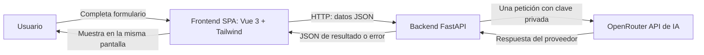
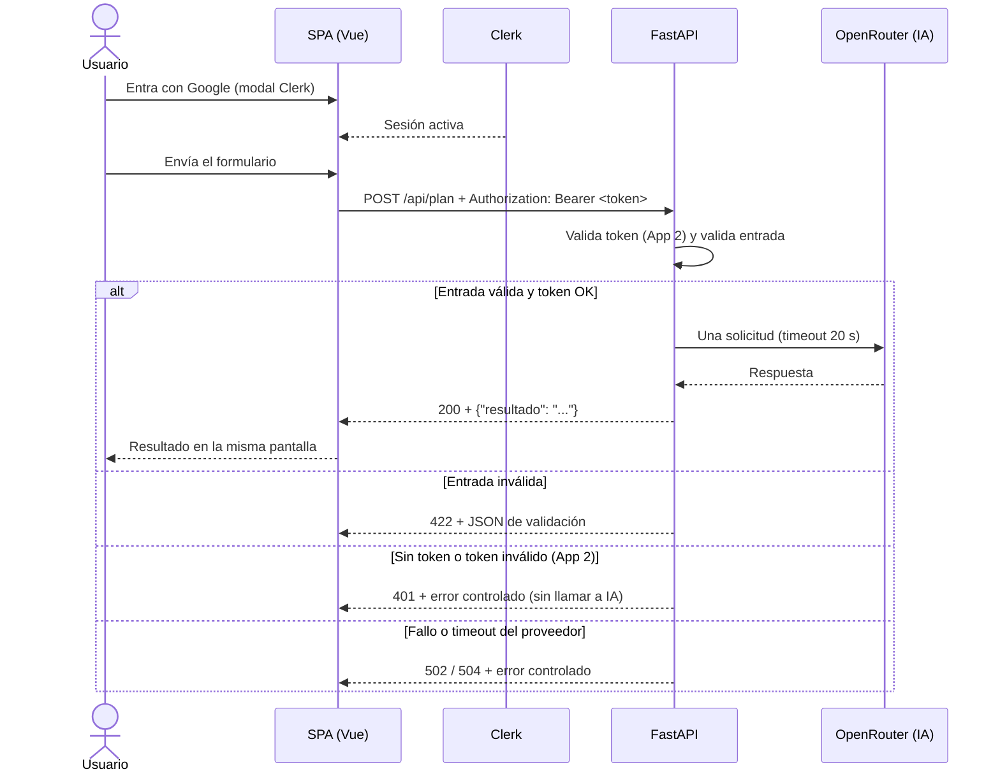

# PLANIFICADOR DE ITINERARIOS — Documento técnico (v3)

> **Práctica PR01-UD1 · «Mini aplicación web con una API de IA»**
> Este documento cubre las **dos aplicaciones equivalentes** que pide el enunciado:
>
> | | **App 1** | **App 2** |
> |---|---|---|
> | Origen | Construcción **manual e incremental** del equipo | **Proyecto nuevo desde cero** con GitHub Spec Kit + asistencia de IA |
> | Identidad | **Sin Clerk** | **Con Clerk** (acceso con Google, modal en la SPA) |
> | Despliegue | **Vercel** (frontend y backend) | **Vercel** (demo de Clerk) + **Docker en AWS EC2** (definitivo) |
>
> **Regla de oro del enunciado:** *una sola pantalla, un solo formulario, una sola función
> útil y una sola API de IA. Sin excepciones.* Cada sección indica si aplica a **[App 1]**,
> **[App 2]** o a **[Ambas]**.

---

## ÍNDICE

1. [Enunciado y restricciones que condicionan el diseño](#1-enunciado-y-restricciones-que-condicionan-el-diseño)
2. [La idea: una sola función útil](#2-la-idea-una-sola-función-útil)
3. [Arquitectura [Ambas]](#3-arquitectura-ambas)
4. [Contrato HTTP [Ambas]](#4-contrato-http-ambas)
5. [App 1 — desarrollo incremental](#5-app-1--desarrollo-incremental)
6. [App 2 — GitHub Spec Kit y Clerk](#6-app-2--github-spec-kit-y-clerk)
7. [Docker y AWS EC2 [App 2]](#7-docker-y-aws-ec2-app-2)
8. [Seguridad y secretos [Ambas]](#8-seguridad-y-secretos-ambas)
9. [Control de versiones [Ambas]](#9-control-de-versiones-ambas)
10. [Errores comunes a evitar](#10-errores-comunes-a-evitar)
11. [Evidencias y rúbrica: dónde se demuestra cada criterio](#11-evidencias-y-rúbrica-dónde-se-demuestra-cada-criterio)
12. [Referencias](#12-referencias)

---

## 1. Enunciado y restricciones que condicionan el diseño

Fuente principal: `PR01-UD1 · Mini aplicación web con una API de IA` (el docente).

### 1.1 Restricciones obligatorias [Ambas]

| ID | Restricción | Consecuencia técnica |
|---|---|---|
| R-01 | Una sola pantalla, un formulario, una función útil | SPA sin Vue Router: todo en `App.vue` |
| R-02 | Una sola API de IA, **una llamada por envío válido** | Un único cliente hacia OpenRouter; sin agentes ni encadenamientos |
| R-03 | Sin bases de datos **ni persistencia** (incluye `localStorage`, `sessionStorage`, IndexedDB, cachés, ficheros de resultados) | El resultado solo vive en la página hasta el siguiente envío o recarga |
| R-04 | Sin CRUD, paneles, dashboards, perfiles ni gestión de usuarios propios | Clerk (App 2) cubre la identidad; no hay tablas ni roles |
| R-05 | Backend **Python + FastAPI** que valida y devuelve JSON | Modelos Pydantic; uvicorn como servidor |
| R-06 | Frontend **Vue.js o React** con **Tailwind CSS** | Elegimos Vue 3 + Vite + Tailwind |
| R-07 | Pruebas con **pytest** y API externa **simulada** | Mocks; la prueba real va documentada aparte |
| R-08 | **Vercel** para frontend y backend de **ambas** apps | Dos proyectos de Vercel por aplicación |
| R-09 | **[App 1]** Desarrollo manual e incremental, proceso distinguible de App 2 | Hitos H0–H7 con aportaciones identificables |
| R-10 | **[App 2]** **GitHub Spec Kit**: especificación, plan y tareas **anteriores** al código | Artefactos versionados en Git antes del primer commit de código |
| R-11 | **[App 2]** **Clerk** para identidad, sin usuarios propios | Modal en la SPA + verificación de token en backend |
| R-12 | **[App 2]** Despliegue final con **Docker en AWS EC2** | `infra/` con Dockerfiles y `compose.yaml`, HTTPS |
| R-13 | La clave de la API de IA vive **solo en backend** | Nada de `VITE_*` con secretos; `.env` fuera de Git |
| R-14 | Resultado de la IA = **contenido no confiable** | Se muestra como texto (sin `v-html`), sin prometer exactitud |

### 1.2 Prohibiciones expresas (sin excepciones)

- Bases de datos de cualquier tipo (SQL, NoSQL, SQLite, **en memoria**, vectoriales).
- Persistencia de la aplicación: históricos, cachés, `localStorage`, `sessionStorage`, IndexedDB.
- Segunda pantalla, vista o ruta; **no se usa router**.
- Chat con historial, RAG, subida de archivos, colas, procesos en segundo plano, servicios extra.
- **[App 2]** Páginas de login/registro/perfil: el acceso va en un **modal de la misma SPA**.

---

## 2. La idea: una sola función útil

**Planificador de itinerarios (versión simplificada).**

> **Quién la usa y para qué (una frase):** una persona que visita una ciudad quiere ideas
> sencillas para un día; introduce ciudad, fecha, cuántas personas van y qué le gusta, y la
> app le devuelve un plan de un día escrito, **en la misma pantalla**.

| Elemento | Definición |
|---|---|
| Entrada (formulario único) | `ciudad`, `fecha`, `personas`, `gustos` (p. ej. «museos y tapas») |
| Proceso | FastAPI valida → **una** llamada a OpenRouter → envuelve la respuesta |
| Resultado único | Texto con el plan de un día, mostrado debajo del formulario |
| API de IA | **OpenRouter**, modelo `:free` (p. ej. `nvidia/nemotron-3-ultra-550b-a55b:free`) — proveedor y modelo documentados |

**Qué se ha retirado respecto a versiones anteriores del proyecto** (por la regla de
simplicidad): consulta a OpenStreetMap/Overpass, `lugares.json`, validador de factibilidad,
mapa, timeline estructurado, caché y backend «con cálculos de traslados». La IA propone el
plan directamente y el resultado se muestra **como texto orientativo, no verificado**.

**[App 1] y [App 2] resuelven la misma necesidad con el mismo contrato**: solo cambia el
proceso de desarrollo, la autenticación y el despliegue.

---

## 3. Arquitectura [Ambas]



> *Flowchart de arquitectura (no es UML formal): aclara quién habla con quién y que la IA
> solo se consulta desde el backend.*

**[App 2]** se añade un paso de identidad **antes** de la llamada a la IA:



> *Diagrama de secuencia: muestra el flujo completo con los cuatro desenlaces posibles y
> que la validación del token de Clerk ocurre **antes** de llamar a la IA (Clerk no es el
> proveedor de IA).*

**Diferencias entre apps:**

| Aspecto | [App 1] | [App 2] |
|---|---|---|
| Bloque de acceso en la pantalla | No existe | Modal/ componente Clerk en la misma SPA |
| Cabecera `Authorization` | No se envía | `Bearer <session token>` obligatoria |
| Respuesta `401` | No aplica | Token ausente/inválido/caducado, sin llamar a IA |
| Proceso | Incremental, manual, por hitos H0–H7 | Spec Kit: especificación → plan → tareas → código (H8–H12) |
| Despliegues | Vercel (H7) | Vercel (H10) + Docker/EC2 (H11) |

---

## 4. Contrato HTTP [Ambas]

Endpoint único de procesamiento: **`POST /api/plan`**. (Un endpoint técnico `GET /api/salud`
opcional no cuenta como pantalla nueva.)

### 4.1 Petición

```json
{
  "ciudad": "Sevilla",
  "fecha": "2026-10-10",
  "personas": 2,
  "gustos": "museos, gastronomía y paseos"
}
```

| Campo | Tipo | Límites (validados en backend con Pydantic) |
|---|---|---|
| `ciudad` | string | obligatoria, 1–80 caracteres |
| `fecha` | string `AAAA-MM-DD` | obligatoria, hoy o futura |
| `personas` | entero | obligatorio, 1–20 |
| `gustos` | string | obligatorio, 1–200 caracteres |

### 4.2 Respuestas

| Código | Cuándo | Cuerpo |
|---|---|---|
| `200` | Éxito | `{"resultado": "Texto del plan de un día"}` |
| `422` | Validación de entrada (FastAPI/Pydantic) | Esquema estándar `{"detail": [...]}`, tratado por el frontend |
| `401` **[App 2]** | Token ausente, inválido o caducado | `{"error": {"codigo": "NO_AUTENTICADO", "mensaje": "Inicia sesión para continuar."}}` |
| `502` | El proveedor de IA falla | `{"error": {"codigo": "IA_NO_DISPONIBLE", "mensaje": "No se ha podido completar la petición. Inténtalo más tarde."}}` |
| `504` | Timeout del proveedor (> 20 s) | `{"error": {"codigo": "IA_TIMEOUT", "mensaje": "La IA tardó demasiado. Inténtalo de nuevo."}}` |
| `500` | Error inesperado | `{"error": {"codigo": "ERROR_INTERNO", "mensaje": "Error interno."}}` — **sin stack trace ni secretos** |

**Reglas del contrato:**

- El backend **no** devuelve la respuesta cruda del proveedor con metadatos: solo `resultado` o `error`.
- El modelo puede devolver texto plano; FastAPI lo envuelve en `{"resultado": "..."}`. Si se
  pide JSON al modelo, **el backend es responsable de validarlo**.
- Timeout configurado por variable de entorno (`AI_TIMEOUT=20`) y **probado con mock**.
- Máximo de entrada documentado arriba (límite de longitud de `gustos`).
- El frontend muestra el resultado **como texto** (sin interpretar HTML ni scripts) y no
  promete exactitud.

---

## 5. App 1 — desarrollo incremental

> Construcción **manual y progresiva** del equipo: decisiones y código comprendidos por sus
> integrantes. Se puede consultar documentación y pedir explicaciones puntuales a IA
> **si se registran** en `docs/uso-ia.md`; no se delega la generación integral.

### 5.1 Stack [App 1]

- **Vue 3** (Composition API, `<script setup>`, montaje mínimo) + **Vite**
- **Tailwind CSS** (lectura, contraste, móvil, foco de teclado, mensajes de error)
- **fetch** o Axios para la única llamada `POST /api/plan`
- **FastAPI + Pydantic** (validación) servido por **uvicorn**
- **pytest** con el cliente de IA simulado
- Sin Pinia ni Vue Router: una pantalla no los necesita

### 5.2 Estructura de carpetas [App 1]

```text
app1/
├── backend/
│   ├── main.py              # exporta app = FastAPI(); endpoint POST /api/plan
│   ├── ia.py                # cliente de OpenRouter (separable para mockear)
│   ├── requirements.txt     # dependencias fijadas (o pyproject.toml + lock)
│   ├── .env.example         # solo nombres y valores ficticios
│   └── tests/
│       └── test_plan.py     # pytest con la llamada a IA simulada
└── frontend/
    ├── package.json
    ├── vite.config.js
    ├── .env.example         # VITE_API_BASE_URL (URL pública, sin secretos)
    └── src/
        ├── main.js
        ├── App.vue          # ⭐ LA ÚNICA PANTALLA (formulario + resultado)
        └── style.css         # Tailwind
```

### 5.3 La pantalla única [App 1]

```text
┌─────────────────────────────────────────────┐
│  Planificador de itinerarios                │
├─────────────────────────────────────────────┤
│  Formulario: ciudad · fecha · personas ·    │
│  gustos            [ Generar plan ]         │
├─────────────────────────────────────────────┤
│  Estados (solo uno visible):                │
│  · entrada   → formulario listo             │
│  · espera    → spinner + botón deshabilitado│
│  · resultado → texto del plan               │
│  · error     → mensaje + botón reintentar   │
└─────────────────────────────────────────────┘
```

- **Envíos duplicados impedidos**: mientras hay una petición pendiente, el botón está deshabilitado.
- La validación en cliente ayuda al usuario; **no sustituye** a la del backend.
- **No se acumulan resultados**: un nuevo envío reemplaza al anterior; nada se guarda (R-03).

### 5.4 Backend [App 1]

```python
# app1/backend/main.py
from datetime import date
from fastapi import FastAPI, HTTPException
from fastapi.middleware.cors import CORSMiddleware
from pydantic import BaseModel, Field, field_validator

from ia import consultar_ia        # en tests se sustituye por un mock

app = FastAPI(title="Planificador de itinerarios")

app.add_middleware(
    CORSMiddleware,
    allow_origins=["http://localhost:5173"],   # en Vercel: origen real del frontend
    allow_methods=["POST"],
)


class Entrada(BaseModel):
    ciudad: str = Field(min_length=1, max_length=80)
    fecha: str = Field(pattern=r"^\d{4}-\d{2}-\d{2}$")
    personas: int = Field(ge=1, le=20)
    gustos: str = Field(min_length=1, max_length=200)

    @field_validator("fecha")
    @classmethod
    def fecha_no_pasada(cls, v: str) -> str:
        if v < date.today().isoformat():
            raise ValueError("la fecha no puede ser pasada")
        return v


@app.post("/api/plan")
def crear_plan(entrada: Entrada):
    try:
        texto = consultar_ia(entrada)          # UNA llamada, con timeout
    except TimeoutError:
        raise HTTPException(504, {"error": {"codigo": "IA_TIMEOUT",
                                            "mensaje": "La IA tardó demasiado. Inténtalo de nuevo."}})
    except Exception:
        raise HTTPException(502, {"error": {"codigo": "IA_NO_DISPONIBLE",
                                            "mensaje": "No se ha podido completar la petición. Inténtalo más tarde."}})
    return {"resultado": texto}                # el proveedor nunca sale tal cual
```

- **uvicorn** (`uvicorn main:app --reload`) es el servidor; **la validación de campos la
  hace FastAPI/Pydantic** antes de entrar en la lógica y devuelve `422` con el detalle de cada campo.
- La clave (`AI_API_KEY`), el modelo (`AI_MODEL`) y el timeout (`AI_TIMEOUT`) se leen de
  **variables de entorno**, nunca están en el código.
- `ia.py` está separado a propósito: es lo que se sustituye con un mock en los tests.

### 5.5 Pruebas con pytest [App 1]

La suite **nunca** consulta el servicio real.

| Caso significativo | Qué comprueba |
|---|---|
| Entrada válida | `200`, JSON `{"resultado": ...}` y **una sola** llamada al mock |
| Entrada vacía o solo espacios | `422` y **cero** llamadas a la IA |
| Límite de longitud | `gustos` con 200 caracteres (acepta) y 201 (rechaza) |
| Fallo del proveedor | `502` con el JSON de error acordado, sin stack trace ni secreto |
| Timeout | `504` con el JSON de error acordado |
| Respuesta inesperada del proveedor | Se envuelve o se devuelve `502`, sin romper el contrato |

La prueba real de integración (una, con datos ficticios) se ejecuta a mano y se documenta en
`docs/pruebas.md` con comando, fecha y resultado. Nunca es requisito de la ejecución rutinaria.

**Puesta en marcha local y comprobación [App 1]** (versiones fijadas en `requirements.txt` y
`package-lock.json`; sin conexión a internet para la suite):

```bash
# Backend — http://127.0.0.1:8000
cd app1/backend
python -m venv .venv && source .venv/bin/activate   # Windows: .venv\Scripts\activate
pip install -r requirements.txt
cp .env.example .env        # completar AI_API_KEY, AI_MODEL, AI_TIMEOUT (nunca subir .env)
uvicorn main:app --reload

# Frontend — http://localhost:5173
cd app1/frontend
npm install
cp .env.example .env        # VITE_API_BASE_URL=<URL del backend>
npm run dev

# Pruebas automatizadas (la IA está simulada; no consume créditos)
pytest -v
```

### 5.6 Despliegue en Vercel [App 1]

**Un solo proyecto de Vercel por aplicación**, conectado al mismo repositorio: sirve los
estáticos compilados de Vite **y** la API como función Python. Al compartir origen, el
frontend llama a `/api/plan` en su propio dominio y **no hace falta CORS** en despliegue:

| Proyecto Vercel | Raíz | Qué publica |
|---|---|---|
| `app1` | `app1/` | Estáticos de Vite (`frontend/dist/`) + la API: `api/plan.py` reexporta el `app` de `backend/main.py` y atiende `/api/plan`; dependencias desde `app1/requirements.txt` |

1. **Variables**: `AI_API_KEY`, `AI_MODEL`, `AI_TIMEOUT` en el backend; `VITE_API_BASE_URL` **vacía** en el frontend (mismo origen, sin CORS). **Nunca** una clave en el frontend.
2. **Sin `DOCS_ACTIVOS`**: `/docs`, `/redoc` y `/openapi.json` quedan en `404`.
3. Las **cabeceras de seguridad** (S20) van en `app1/vercel.json` y se aplican tanto a los estáticos como a la API.
4. Distinguir **Development / Preview / Production** y re-desplegar al cambiar variables.
5. Probar desde la URL desplegada un caso válido y uno de error; anotar URL, fecha y versión Git.

```bash
npm install -g vercel && vercel login
cd app1 && vercel link           # raíz de la aplicación
vercel env add AI_API_KEY        # interactivo, sin valores en el historial
vercel deploy && vercel deploy --prod
```

**Comprobación de cierre:** URL pública correcta, JSON válido, ninguna clave en el frontend,
error visible, `curl -I` con las 10 cabeceras, `/docs` en `404` y evidencia de CLI
(una captura del panel no basta).

---

## 6. App 2 — GitHub Spec Kit y Clerk

> **Proyecto nuevo desde cero** (el código de aplicación de `app2/` sigue sin empezar;
> Spec Kit ya está inicializado), *después de terminar App 1*. Resuelve **la misma
> necesidad y el mismo contrato**, no una app más grande.
> **No se copia la implementación de App 1** (conocimiento, necesidad y contrato sí se reutilizan).

### 6.1 Proceso con Spec Kit [App 2]

1. Instalar/inicializar **GitHub Spec Kit oficial** con la integración de GitHub Copilot;
   App 2 está preparada con Spec Kit CLI 1.2.2 y Copilot skills.
2. Principios y restricciones: SPA única, un formulario, cero persistencia, una API IA, tecnologías obligatorias, pruebas con mocks.
3. Generar y **revisar** una especificación completa: problema, usuarios, RF/RNF, casos de uso, contrato, errores, aceptación y autenticación Clerk.
4. Resolver ambigüedades y guardar **especificación y decisiones antes de generar código**.
5. Plan técnico y tareas pequeñas; comprobar coherencia.
6. Implementar **por tareas** con asistencia de IA; revisar código, ejecutar pruebas y registrar correcciones.
7. Comprobar equivalencia funcional con App 1 + criterios de Clerk; **rechazar** cualquier BD, pantalla o función extra que proponga el agente.
8. Versionar artefactos de Spec Kit, prompts depurados, pruebas y revisión: **la especificación debe preceder al código en Git**.

La integración instalada coloca los skills en `app2/.github/skills/`. Abre `app2/` como
carpeta raíz del workspace de VS Code y usa Copilot Chat en modo Agente. En la integración
actual, los pasos son skills del chat (no comandos de terminal) y se invocan con guiones:
`/speckit-constitution`, `/speckit-specify`, `/speckit-clarify`, `/speckit-plan`,
`/speckit-tasks`, `/speckit-analyze` y `/speckit-implement`.

La inicialización deja `app2/.specify/memory/constitution.md` como plantilla. El primer
paso pendiente es ejecutar `/speckit-constitution` con los principios del proyecto; después
generar y revisar la especificación. Los artefactos en `app2/specs/` deben estar revisados
y versionados antes del primer commit de código.

```text
app2/
├── .specify/        # material de Spec Kit (versión instalada)
├── specs/           # spec.md · plan.md · tasks.md · contratos  ← ANTES que el código
├── backend/         # mismo contrato que App 1 + verificación de token
└── frontend/        # misma SPA + Tailwind + componente Clerk
```

En `docs/uso-ia.md` se registra: herramienta/modelo, finalidad, prompt o resumen, propuesta
aceptada/rechazada y comprobación humana. Sin secretos ni conversaciones innecesarias.

### 6.2 Mismo alcance, mismas diferencias [App 2]

Backend, contrato (sección 4), pantalla y pruebas son **equivalentes** a App 1, con tres añadidos:

| Añadido | Detalle |
|---|---|
| Cabecera | `Authorization: Bearer <session token>` en `POST /api/plan` |
| Respuesta `401` | Token ausente/inválido/caducado → error controlado **sin llamar a la IA** |
| Pruebas | Camino autenticado + rechazos con verificador simulado (más una prueba real documentada) |

### 6.3 Clerk en App 2

1. Crear la aplicación en **Clerk** y configurar orígenes/URLs de desarrollo y despliegue (localhost, Vercel y la URL de EC2).
2. Integración con el SDK oficial para Vue y **componente de acceso modal/embebido en la única
   pantalla**. Sin rutas nuevas, sin páginas de perfil, sin gestión de usuarios propia.
3. El frontend obtiene el **session token** y lo envía en `Authorization: Bearer …` al backend.
4. FastAPI valida el token con el mecanismo oficial: **firma, emisor, caducidad y audiencia**
   (SDK/verificador oficial o claves públicas del emisor — **no basta decodificar el JWT**).
5. Sin token o token inválido → **401** y la IA no se consulta.
6. Pruebas con pytest usando un **verificador simulado** + una prueba real controlada de acceso y cierre de sesión.
7. Solo la clave **publishable** de Clerk puede estar en el frontend; la **secret** permanece en backend.

```python
# app2/backend/autenticacion.py (esquema)
from fastapi import Depends, HTTPException

def exigir_sesion(authorization: str | None):
    if not authorization or not authorization.startswith("Bearer "):
        raise HTTPException(401, {"error": {"codigo": "NO_AUTENTICADO",
                                            "mensaje": "Inicia sesión para continuar."}})
    try:
        return verificar_token_clerk(authorization[7:])   # firma, emisor, caducidad, audiencia
    except Exception:
        raise HTTPException(401, {"error": {"codigo": "NO_AUTENTICADO",
                                            "mensaje": "Sesión no válida. Entra de nuevo."}})
```

> Clerk **no es** el proveedor de IA y **no autoriza** a guardar datos: solo dice si la
> petición está autenticada. Cookies/tokens del SDK = autenticación, nada más.

### 6.4 Despliegue de App 2 en Vercel [App 2]

Igual que en 5.6 (dos proyectos: `app2/frontend`, `app2/backend`) más:

- Variables del backend: claves de IA + configuración de Clerk (`CLERK_SECRET_KEY` si aplica).
- Frontend: `VITE_API_BASE_URL` + `VITE_CLERK_PUBLISHABLE_KEY` (pública por diseño).
- CORS con `Authorization` contemplado.
- **Demo en Vercel antes de pasar a EC2**: documentar URLs, configuración no secreta y evidencia
  de una petición rechazada (401) y otra aceptada (200).

---

## 7. Docker y AWS EC2 [App 2]

> Despliegue **definitivo de App 2** con el mismo alcance y autenticación. No se repite App 1 en AWS.

### 7.1 Docker local

```text
infra/
├── Dockerfile.backend     # Python + FastAPI, uvicorn escuchando en 0.0.0.0:<puerto>
├── Dockerfile.frontend    # compila Vite y sirve los estáticos (nginx o similar)
├── compose.yaml           # frontend + backend + proxy opcional (red interna)
├── .env.example           # nombres de variables, sin valores reales
└── proxy/                 # reenvío de /api al backend (URL única de origen)
```

- **Sin servicios de bases de datos, volúmenes de datos funcionales ni cachés.**
- `.dockerignore` excluye `.env`, credenciales, `node_modules`, `.venv` y material innecesario.
- Los secretos **se inyectan al ejecutar** (`-e`/`--env-file`), nunca en el Dockerfile ni en la imagen.
- Las variables `VITE_*` se resuelven **en compilación**: cambiar la URL exige reconstruir;
  el **proxy de mismo origen** simplifica este punto (el navegador no puede usar el nombre interno `backend`).

```bash
docker --version && docker compose version
docker compose build
docker compose up -d && docker compose ps && docker compose logs
# prueba: entrada válida, error, acceso Clerk y reinicio → sin historial (no hay persistencia)
docker compose down
```

### 7.2 EC2 con Docker

1. Confirmar acceso, región y presupuesto con el docente; revisar costes antes de crear recursos.
2. Instancia EC2 pequeña para la demo; clave SSH protegida; anotar SO, región y tamaño.
3. Grupo de seguridad: **SSH solo desde IPs autorizadas** y solo los puertos web necesarios.
4. Instalar Docker + Compose; traer el código del repositorio **sin credenciales**.
5. Secretos en el servidor, fuera del repositorio y con permisos restringidos; levantar contenedores.
6. **URL pública con HTTPS** (proxy con TLS + DNS) para poder probar Clerk con tokens.
   No se envían credenciales por HTTP.
7. Probar desde otro dispositivo: frontend, acceso, respuesta IA y errores; anotar URL, versión Git, puertos y procedimiento de actualización.
8. Documentar recuperación tras reinicio y política de reinicio simple de contenedores.
9. **Retirar recursos al finalizar** siguiendo al docente (discos e IPs reservadas también cuestan).

**Evidencia mínima:** Dockerfile(s), `compose.yaml`, configuración no secreta, instrucciones
reproducibles y captura/registro de la demo funcionando en EC2.

---

## 8. Seguridad y secretos [Ambas]

- `AI_API_KEY` **solo en backend** (Vercel: variables del proyecto; EC2: entorno del contenedor).
- `CLERK_SECRET_KEY` **solo en backend**; `VITE_CLERK_PUBLISHABLE_KEY` es pública por diseño.
- `.env.example` con nombres y valores ficticios; `.env`, tokens, claves SSH y credenciales AWS
  **fuera de Git y fuera de las imágenes Docker**.
- Revisar historial antes de publicar; si se filtra un secreto → **revocar/rotar** y avisar al docente.
- Dependencias fijadas (lockfile) y versiones documentadas.
- Datos ficticios y entradas acotadas: no se envían datos personales a la API de IA.
- Autenticación, CORS y HTTPS **son cosas distintas**: ocultar el botón no protege el backend.
- Resultado de la IA mostrado **como texto**, sin ejecutar HTML ni código devuelto.

```gitignore
.env
.env.*
!.env.example
.venv/
__pycache__/
.pytest_cache/
node_modules/
dist/
.vercel/
*.pem
*.key
```

---

## 9. Control de versiones [Ambas]

Un repositorio por grupo; cada integrante con su identidad y contribuciones identificables.

| Hito | App | Evidencia que debe verse en Git |
|---|---|---|
| H0 · Inicio | 1 | README, exclusiones, estructura, `.gitignore` y ERS inicial |
| H1 · Backend mínimo | 1 | Petición real a IA y respuesta visible |
| H2 · Contrato y errores | 1 | JSON estable, validaciones y fallo controlado |
| H3 · Pruebas | 1 | pytest con mocks y casos significativos |
| H4 · Frontend | 1 | Formulario mínimo y resultado |
| H5 · Integración | 1 | Flujo completo con estados de espera y error |
| H6 · Diseño y revisión | 1 | Tailwind, revisión de ERS y documentación |
| H7 · Vercel App 1 | 1 | Configuración reproducible y URLs verificadas |
| H8 · Spec Kit | 2 | Especificación, plan y tareas **anteriores** al código |
| H9 · App 2 | 2 | Implementación progresiva, revisión IA y pruebas |
| H10 · Clerk y Vercel | 2 | Validación backend, pruebas de acceso y despliegue |
| H11 · Docker y AWS | 2 | Contenedores locales, EC2 y evidencias |
| H12 · Cierre | Ambas | Comparativa, documentación y presentación |

No se exige un número literal de commits, pero **un único commit final no demuestra proceso**.
Etiquetas recomendadas: `app1-final`, `entrega-ud1`. Sin secretos en el historial.

**Documentación asociada** (repartida según el enunciado): `README.md`, ERS
(`ERS.md`, en la misma carpeta que este documento), `proceso.md`, `pruebas.md`,
`comparativa.md`, `despliegues.md`, `uso-ia.md`, `diagramas/` y `evidencias/` (datos
ficticios y capturas **sin secretos**).

---

## 10. Errores comunes a evitar

| Error | Corrección |
|---|---|
| «Solo una pequeña localStorage para el último plan» | Retirar: la prohibición no admite excepciones |
| Login de Clerk en otra ruta o página de perfil | Modal embebido en la única SPA; nada de rutas nuevas |
| Clave IA en `VITE_...` | Moverla a backend, revocarla y revisar el historial |
| El frontend llama directamente a la API de IA | Todo pasa por FastAPI (flujo obligatorio) |
| Tests que consumen la API real | Mock obligatorio; la prueba real va documentada aparte |
| Login visible pero backend abierto | Verificar el token **antes** de llamar a IA y probar el rechazo directo (401) |
| Especificación de App 2 escrita al final | Rehacer el proceso: spec/plan/tareas antes que el código |
| Copiar App 1 como si fuera App 2 | App 2 se crea desde cero; solo se reutilizan conocimiento, necesidad y contrato |
| Vercel funciona solo en local | Revisar raíces, dependencias, `VITE_API_BASE_URL`, URL pública y CORS |
| EC2 con HTTP y tokens o con la URL interna `backend` | HTTPS público + proxy/orígenes correctos |
| Añadir BD, CRUD o pantallas «para mejorar» | La rúbrica lo penaliza: retirar la ampliación |
| Resultado de la IA inyectado con `v-html` | Mostrar como texto plano |
| Todos los commits al final | Historial incremental con hitos H0–H12 |

---

## 11. Evidencias y rúbrica: dónde se demuestra cada criterio

Mapa directo de la **rúbrica de evaluación (sección 12 del enunciado)** para que nada del
«100 %» quede sin evidencia. *Los documentos no sustituyen la evidencia ejecutable: la
rúbrica puntúa lo que se puede mostrar y reproducir.*

| Criterio | Peso | Exige «Excelente» (resumen) | Dónde se demuestra |
|---|---:|---|---|
| ERS y análisis | 15 % | Plantilla fiel, RF/RNF verificables, errores y trazabilidad completa, diagramas útiles, «No aplica» motivados | `ERS.md` (5 RF + 4 RNF con «Dado/cuando/entonces», sección 8 trazabilidad, 2 diagramas Mermaid con frase explicativa, 10.1 con motivaciones) |
| Aplicación 1 | 20 % | Flujo completo y estable, FastAPI + JSON, SPA Vue con Tailwind, validación/espera/error | Código de `app1/` siguiendo §5; demo del flujo (entrada válida → resultado) |
| Calidad técnica, tests y Git | 15 % | Pruebas aisladas con mocks, dependencias reproducibles, secretos protegidos, historial incremental identificable | `app1/backend/tests/` + `docs/pruebas.md` (§5.5); `requirements.txt`/lockfiles; `.gitignore` + `.env.example` (§8); hitos H0–H7 (§9) |
| App 2, Spec Kit e IA | 15 % | Proyecto nuevo equivalente, spec/plan/tareas **previos** al código, revisión humana y comparativa con evidencias | `app2/.specify/` y `app2/specs/` con fecha de commit anterior al código (§6.1); `docs/uso-ia.md`; `docs/comparativa.md` |
| Vercel, Clerk, Docker y AWS | 15 % | Ambas apps en Vercel + CLI, Clerk validado en backend, App 2 en contenedores y EC2 con HTTPS, todo reproducible | `docs/despliegues.md` (URLs, comandos CLI, evidencias); §5.6, §6.3–6.4, §7; prueba de rechazo 401 (CA-RF05-01) |
| Documentación | 10 % | README y documentos claros: versiones, comandos, URLs, problemas y configuración **no secreta** reproducible | `README.md` (puerta de entrada) + `docs/proceso.md`, `docs/pruebas.md`, `docs/comparativa.md`, `docs/despliegues.md`, `docs/uso-ia.md` |
| Exposición, demo y defensa | 10 % | Presentación legible, demo preparada, todos defienden decisiones con evidencias | `presentacion/defensa.pptx` (estructura en el README) + demo mínima de 5 puntos (sección 11 del enunciado) |

**Checklist de cierre antes de declarar la entrega** (adaptado de la sección 13 del
enunciado; el detalle vive en `README.md`):

- [ ] Una función útil, una pantalla/formulario, una API de IA y una llamada por envío válido.
- [ ] Sin BD, persistencia, CRUD, pantallas nuevas ni gestión propia de usuarios.
- [ ] ERS según plantilla + trazabilidad + «No aplica» motivados.
- [ ] pytest con mocks (sin llamadas reales rutinarias) y prueba real documentada.
- [ ] Historial incremental con hitos H0–H12 y contribuciones de todos.
- [ ] App 1 y App 2 en Vercel (frontend + backend), variables y URLs verificadas + CLI.
- [ ] Spec Kit con spec/plan/tareas **anteriores** al código; `docs/uso-ia.md` completo.
- [ ] Clerk: 401 probado sin token y acceso con Google funcionando en la única pantalla.
- [ ] Docker local reproducible + App 2 en EC2 con HTTPS.
- [ ] Ningún secreto en código, historial, imágenes, capturas ni presentación.
- [ ] Entrega previa accesible para el docente + PPT propio del grupo.

---

## 12. Referencias

- Enunciado: `PR01-UD1 · Mini aplicación web con una API de IA` (el docente).
- Plantilla ERS: `plantillaERS.md` del docente → versión del equipo
  (`ERS.md`).
- FastAPI en Vercel: <https://vercel.com/docs/frameworks/backend/fastapi> · CLI: <https://vercel.com/docs/cli> · Variables de entorno: <https://vercel.com/docs/environment-variables>
- GitHub Spec Kit: <https://github.com/github/spec-kit>
- Clerk: tokens de sesión <https://clerk.com/docs/guides/sessions/session-tokens> · verificación manual de JWT <https://clerk.com/docs/guides/sessions/manual-jwt-verification>
- OpenRouter (modelos `:free`): <https://openrouter.ai/models?max_price=0>
- Vue 3 <https://vuejs.org/> · Vite <https://vite.dev/> · Tailwind CSS <https://tailwindcss.com/>
- AWS EC2: grupos de seguridad <https://docs.aws.amazon.com/AWSEC2/latest/UserGuide/ec2-security-groups.html>
- Documentación técnica consultada el **6 de octubre de 2026** (contrastar versiones antes de usar ejemplos).
